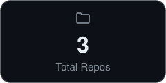
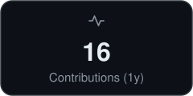
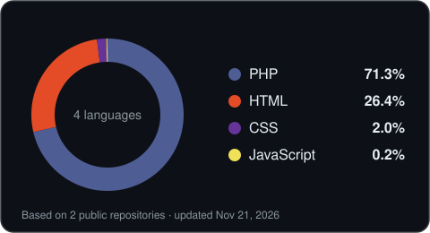

# Hi, I'm Oscar 👋

### Systems Engineering Student · PHP Developer · MySQL & SQL · MVC Architecture

📍 Barrancabermeja, Santander, Colombia

  
  
  
  

### 🟡 Contributions

  

<table>
  <tr>
    <td width="50%" valign="top">
      <h3>🧰 Core Technologies</h3>
      

        
        <picture></picture>
        <picture></picture>
        
        
        
        <picture></picture>
      

      
<b>Tools:</b> Git · GitHub · VS Code · XAMPP

    </td>
    <td width="50%" valign="top">
      <h3>📊 Languages</h3>
      
    </td>
  </tr>
</table>

### 🔖 Featured Projects

<table>
  <tr>
    <td width="260" align="center" valign="middle">
      <picture>
        
      </picture>
    </td>
    <td valign="middle">
      <h3>ECOLOGIX</h3>
      <b>Environmental Management System</b>
      
Web application for environmental management in the transport sector, developed with PHP MVC.

      

        <code>PHP</code> <code>MySQL</code> <code>MVC</code> <code>PDO</code>
      

      

        
      

    </td>
  </tr>
</table>

**ECOLOGIX** is an environmental management web system for a transport company, built as an academic team project. I was the main developer: database design, PHP MVC structure, backend, CRUD operations and module integration.
