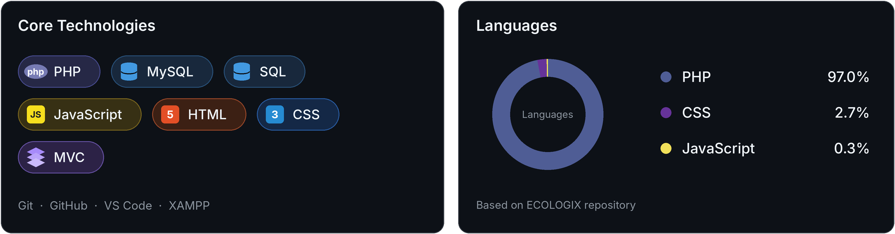
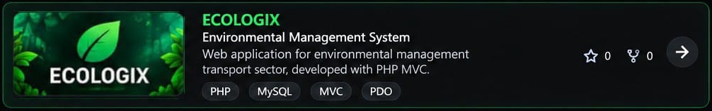

# Hi, I'm Oscar 👋

### Systems Engineering Student · PHP Developer · MySQL & SQL · MVC Architecture

📍 Barrancabermeja, Santander, Colombia

### 🟡 Contributions

  

### 🔖 Featured Projects

**ECOLOGIX** is an environmental management web system for a transport company, built as an academic team project. I was the main developer: database design, PHP MVC structure, backend, CRUD operations and module integration.

[👉 View repository / Ver repositorio](https://github.com/OscarGonzalezwr1/Ecologix)
